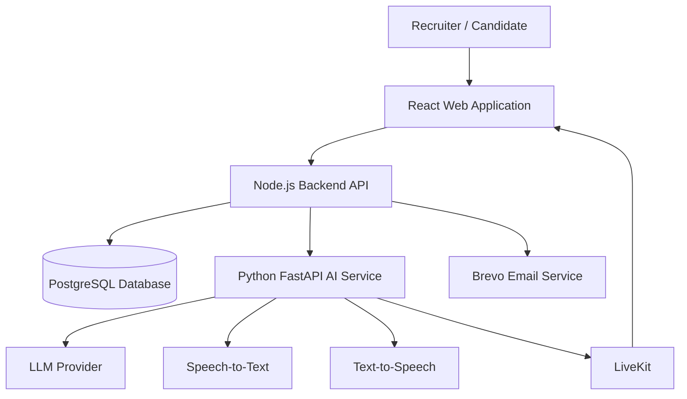

# Aarohi Recruiter — AI-Powered Recruitment Platform

**Aarohi Recruiter** is an AI-powered recruitment and candidate assessment platform designed to streamline the hiring process through intelligent resume screening, adaptive voice interviews, and evidence-based candidate evaluation.

The platform combines a recruiter-facing dashboard, a centralized backend API, and an AI service to deliver an integrated recruitment workflow.

## Overview

Aarohi Recruiter aims to simplify the recruitment lifecycle:

1. **Job Management** — Create and manage job descriptions and hiring requirements.
2. **Resume Screening** — Analyze candidate resumes against job requirements and identify relevant skills, experience, and qualifications.
3. **AI Interview Scheduling** — Invite candidates to secure, personalized interview sessions.
4. **AI Voice Interviews** — Conduct interactive interviews using Aarohi, the AI interview assistant.
5. **Candidate Evaluation** — Generate structured, evidence-based interview assessments.
6. **Recruiter Decision-Making** — Provide recruiters with insights to support informed hiring decisions.

## Monorepo Architecture

Aarohi Recruiter follows a monorepo architecture. Its frontend, backend API, and AI service are maintained in one repository while remaining independently deployable applications.

```text
Aarohi-Recruiter/
│
├── apps/
│   ├── web/                  # React recruiter dashboard and candidate interface
│   ├── api/                  # Node.js backend and business APIs
│   └── ai-service/           # Python-based AI and conversational services
│
├── docs/                     # Architecture and technical documentation
│
├── .gitignore                # Global Git ignore rules
├── package.json              # Root workspace configuration
└── README.md                 # Main project documentation
```

## Applications

### 1. `apps/web` — Frontend Application

**Technology:** React 18, TypeScript, Vite, Tailwind CSS

The web application provides two connected user experiences:

**Recruiter Experience**
- Recruitment dashboard and overview.
- Job description management.
- Candidate and application management.
- Resume screening results.
- Interview scheduling and management.
- Candidate assessment reports.

**Aarohi Candidate Experience**
- Secure interview entry.
- Candidate consent and device checks.
- Real-time video interview interface.
- AI voice interaction and interview progress.
- Interview completion experience.

**Design System:** Aurora Intelligence

The interface follows a consistent visual language using Midnight Indigo, Aurora Violet, Soft Lavender, and Cloud White, with Lucide React icons.

Documentation: [`apps/web/README.md`](apps/web/README.md)

### 2. `apps/api` — Backend Application

**Technology:** Node.js, Express, TypeScript, PostgreSQL, Prisma

The backend API manages the platform's core business operations and application data.

Responsibilities include:
- Authentication and authorization.
- Organization and user management.
- Job and candidate management.
- Resume and application workflows.
- Interview scheduling and lifecycle management.
- Secure candidate interview access.
- Email invitation integration.
- Communication with the AI service.
- Persistence of screening and interview-related data.

The API acts as the central business layer between the frontend, database, and AI service.

Documentation: [`apps/api/README.md`](apps/api/README.md)

### 3. `apps/ai-service` — AI & Conversational Intelligence

**Technology:** Python, FastAPI, LiveKit

This service powers **Aarohi**, the AI interview assistant.

Its responsibilities include:
- Resume intelligence and AI-powered screening.
- Job-description-aware interview preparation.
- Adaptive interview question generation.
- Real-time conversational AI orchestration.
- Speech-to-Text (STT) processing.
- Large Language Model (LLM) integration.
- Text-to-Speech (TTS) generation.
- Interview answer analysis and evaluation capabilities.

The AI service uses provider abstractions to keep AI integrations modular and easier to maintain.

Documentation: [`apps/ai-service/README.md`](apps/ai-service/README.md)

## Technology Stack

| Layer | Technologies |
|---|---|
| Frontend | React, TypeScript, Vite |
| Styling | Tailwind CSS |
| Backend | Node.js, Express, TypeScript |
| AI Service | Python, FastAPI |
| Database | PostgreSQL |
| ORM | Prisma |
| Real-Time Communication | LiveKit |
| AI / LLM | Gemini and configurable provider integrations |
| Speech Processing | STT and TTS provider integrations |
| Email | Brevo |
| Version Control | Git and GitHub |

## Application Architecture



**Architecture responsibilities:**

- **Web:** User interface and candidate interview experience.
- **API:** Authentication, business logic, authorization, and data management.
- **AI Service:** AI orchestration, resume intelligence, and conversational interview capabilities.
- **PostgreSQL:** Persistent application data.
- **LiveKit:** Real-time interview audio/video communication.

## Getting Started

### Prerequisites

Install the following before running the project:

- Node.js and npm
- Python 3.12+
- PostgreSQL
- Git

### Clone the Repository

```bash
git clone https://github.com/YOUR_USERNAME/aarohi-recruiter.git

cd aarohi-recruiter
```

### Frontend and Backend

Install the root workspace dependencies:

```bash
npm install
```

Use the individual application README files for the exact development and startup commands.

### AI Service

Navigate to the AI service:

```bash
cd apps/ai-service
```

Create and activate a Python virtual environment, install the dependencies, and configure the required environment variables according to the AI service README.

## Environment Configuration

Each application may require its own environment configuration.

Use `.env.example` files to document required variables.

Typical configuration categories include:

- Database connection.
- Authentication and JWT secrets.
- Internal API-to-AI-service authentication.
- AI provider credentials.
- LiveKit configuration.
- Email service credentials.

**Security:** Never commit actual `.env` files, API keys, credentials, private candidate information, or production secrets to GitHub.

## Project Documentation

For application-specific setup and implementation details:

- [Frontend Documentation](apps/web/README.md)
- [Backend API Documentation](apps/api/README.md)
- [AI Service Documentation](apps/ai-service/README.md)

## Development Principles

Aarohi Recruiter is developed with an emphasis on:

- Modular and maintainable architecture.
- Separation of business logic and AI orchestration.
- Secure authentication and authorization.
- Tenant-aware data access.
- Evidence-based candidate assessment.
- Responsible AI-assisted hiring.
- Human oversight in recruitment decisions.
- Independent application deployment.

## Project Status

Aarohi Recruiter is under active development. Individual features and integrations may have different implementation and testing statuses.

## License

License information will be added when the project license is finalized.
