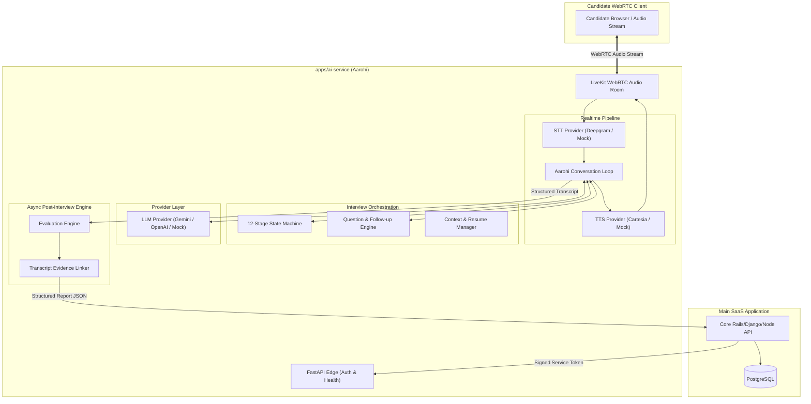

# Aarohi AI Service - System Architecture

## 1. Architectural Philosophy

The Aarohi AI Service is engineered as a resilient, real-time, provider-agnostic voice interview microservice designed for enterprise SaaS scale.

### Core Architectural Decisions

1. **Separation of Conversation & Evaluation**:
   The conversational agent (Aarohi) focuses exclusively on engaging the candidate, asking questions, and gathering responses. She does *not* calculate candidate ratings or make hiring recommendations in real-time. Candidate assessment is decoupled into an asynchronous, rubric-driven Evaluation Engine.

2. **Deterministic Orchestration vs. Generative Autonomy**:
   While the LLM dynamically formulates context-aware questions and follow-ups, it is strictly forbidden from independently skipping interview phases (e.g. bypassing technical or behavioral questions). The interview progression is enforced by a state machine managed by backend code.

3. **Pluggable Multi-Provider Abstraction**:
   All AI capabilities (LLM, STT, TTS) sit behind abstract Python interfaces (`BaseLLMProvider`, `BaseSTTProvider`, `BaseTTSProvider`). The system ships with Gemini 2.0 Flash as the primary LLM, Deepgram as STT, and Cartesia as TTS, with full mock provider implementations for deterministic offline testing.

4. **Cryptographic Multi-Tenancy**:
   No client or candidate input is trusted for tenant routing. Service tokens signed by the main SaaS backend cryptographically assert `org_id` and `interview_id`. Requests crossing tenant boundaries are rejected at the edge.

---

## 2. High-Level System Architecture Diagram



---

## 3. Directory Layout & Module Responsibilities

```
apps/ai-service/app/
│
├── api/                        # HTTP Layer
│   ├── routes/                 # Health checks, diagnostics, session endpoints
│   ├── dependencies/           # Service token authentication & tenant context
│   └── middleware/             # Correlation ID tracking & domain error masking
│
├── core/                       # Foundational Infrastructure
│   ├── config.py               # Pydantic v2 typed environment settings & production gates
│   ├── logging.py              # Structured JSON logging & regex PII scrubber
│   ├── exceptions.py           # Domain exception hierarchy
│   ├── security.py             # HMAC-SHA256 service tokens & tenant boundary assertions
│   └── lifecycle.py            # FastAPI lifespan, startup checks & graceful shutdown
│
├── agents/aarohi/              # Agent Implementation
│   ├── persona/                # Aarohi behavioral rules, voice profile & ethics guidelines
│   ├── prompts/                # Modular system prompts, language rules & stage guidance
│   ├── conversation/           # Active dialogue turn manager & interruption listener
│   ├── workflows/              # Interview stage transition logic
│   ├── tools/                  # Structured function call tools (e.g. repeat_question, switch_language)
│   ├── policies/               # Safety guards, AI disclosure enforcement, timeout guardrails
│   └── state/                  # Conversation turn history, token accumulator, state store
│
├── realtime/                   # WebRTC & Live Audio Transport
│   ├── livekit/                # LiveKit Agents worker & room connection manager
│   ├── sessions/               # Live session state & reconnection handling
│   └── events/                 # Audio stream events, vad events & participant triggers
│
├── pipelines/                  # Streaming Pipeline Connectors
│   ├── stt/                    # Speech-to-Text streaming audio pipeline
│   ├── llm/                    # Streaming text generation pipeline
│   └── tts/                    # Text-to-Speech audio synthesizer pipeline
│
├── providers/                  # External Service Adapters
│   ├── interfaces/             # Abstract Base Classes (LLM, STT, TTS)
│   ├── llm/                    # Gemini 2.0 Flash, OpenAI, Mock implementations
│   ├── stt/                    # Deepgram Nova-2, Mock implementations
│   └── tts/                    # Cartesia Sonic Multilingual, Mock implementations
│
├── interview/                  # Domain Business Logic
│   ├── orchestration/          # Multi-stage interview execution manager
│   ├── question_engine/        # Question sequencing & contextual follow-up generation
│   ├── session_manager/        # Active interview session registry & isolation
│   ├── context_manager/        # Authorized job description & candidate profile loader
│   └── lifecycle/              # Session initiation, pause, reconnect, termination
│
├── evaluation/                 # Separate Post-Interview Evaluation Engine
│   ├── engine/                 # Rubric analysis engine
│   ├── rubrics/                # Job-specific scoring schemas & criteria
│   ├── evidence/               # Transcript citation & observation linker
│   └── reports/                # Structured evaluation JSON output generator
│
├── schemas/                    # Pydantic Schemas
│   └── common.py               # Shared data transfer objects
├── services/                   # High-level domain service coordinators
├── workers/                    # Background async task workers
└── utils/                      # Helper routines
```

---

## 4. Key Design Patterns Applied

- **Dependency Injection**: Route handlers and agent components receive configuration and provider instances via typed dependencies, facilitating 100% test isolation.
- **Provider Pattern**: Abstract interfaces isolate external AI vendor APIs, allowing runtime switching between Google Gemini, OpenAI, or Mock adapters without rewriting application code.
- **Finite State Machine (FSM)**: Interview progression is governed by strict stage gates. Transitioning to a stage requires passing prerequisite completion conditions.
- **Context Variable Scoping**: Request correlation IDs, tenant IDs (`org_id`), and interview IDs are bound to Python `contextvars` to enrich logs without passing IDs across every method call.
