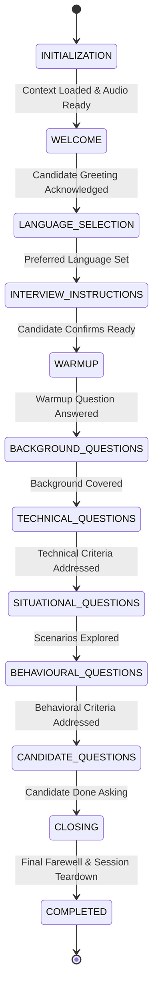

# Aarohi Conversation Engine & State Machine

## 1. The 12 Mandatory Interview Stages

Aarohi follows a deterministic, backend-controlled Finite State Machine (FSM). The LLM cannot unilaterally skip or alter the sequence of stages.

### Stage Definitions & Gate Criteria

| Stage # | Stage Name | Purpose & Activities | Gate Completion Criteria |
|---|---|---|---|
| 1 | `INITIALIZATION` | Validate service token, load JD & candidate profile, verify WebRTC audio room. | Room connected, context injected. |
| 2 | `WELCOME` | Greet candidate, disclose AI identity, state role being interviewed for. | Candidate acknowledges audio/greeting. |
| 3 | `LANGUAGE_SELECTION` | Offer English, Hindi, or Hinglish; confirm candidate choice. | Language choice explicitly recorded. |
| 4 | `INTERVIEW_INSTRUCTIONS` | Explain format, estimated duration (~30-45 mins), reassure pauses/repeat questions. | Candidate confirms readiness to proceed. |
| 5 | `WARMUP` | Ask light, low-stakes introductory question (e.g. self-introduction). | Candidate completes introductory response. |
| 6 | `BACKGROUND_QUESTIONS` | Explore past projects, career trajectory, core tools mentioned on CV. | Core background questions answered. |
| 7 | `TECHNICAL_QUESTIONS` | Job-specific competency questions + dynamic technical follow-ups. | Technical rubric questions addressed. |
| 8 | `SITUATIONAL_QUESTIONS` | Problem-solving scenarios (e.g. debugging outage, architecture trade-offs). | Problem-solving approach demonstrated. |
| 9 | `BEHAVIOURAL_QUESTIONS` | Collaboration, conflict resolution, deadlines, ownership (STAR format). | Behavioral questions answered. |
| 10 | `CANDIDATE_QUESTIONS` | Inquire: *"Do you have any questions for me or about the team?"* | Candidate asks questions or indicates none. |
| 11 | `CLOSING` | Reassure next steps (recruiter timeline), express gratitude, warm sign-off. | Aarohi delivers closing statement. |
| 12 | `COMPLETED` | Disconnect WebRTC room, finalize transcript, trigger evaluation pipeline. | Session persisted and sealed. |

---

## 2. Dynamic Real-Time Event Handlers

### Interruption Handling (Barge-In)
- When candidate speech is detected by Voice Activity Detection (VAD) while Aarohi is speaking, TTS output is immediately paused and cancelled.
- Aarohi stops speaking, transitions to `LISTENING` state, and absorbs the candidate's input.

### Question Repetition / Clarification
- If a candidate asks "Could you repeat that?" or "Can you rephrase?", Aarohi invokes the `repeat_question` tool.
- Aarohi delivers the question again or provides a simplified clarification without penalizing the candidate.

### Language Switching & Code-Switching
- The candidate can switch languages at any point (e.g. "Can we speak in Hindi?").
- Aarohi immediately acknowledges and adapts her responses to the new language without restarting the interview or stage.

### Silence & Latency Detection
- **3 seconds**: Normal candidate thinking pause; Aarohi remains silent.
- **7 seconds**: Aarohi gently checks in: *"Take your time, let me know if you'd like me to rephrase the question."*
- **15+ seconds**: Aarohi asks: *"Are you still with me? If you had technical issues, please let me know."*

### Speech Recognition & Audio Failures
- If STT returns empty or low-confidence transcription, Aarohi politely asks: *"Sorry, I didn't quite catch that. Could you please say that again?"*

### Network Interruption & Controlled Reconnection
- If the WebRTC connection drops, the session transitions to `PAUSED` in Redis with a 5-minute reconnection window.
- When the candidate reconnects, Aarohi retrieves the previous state: *"Welcome back! We were discussing [topic]. Would you like to pick up where we left off?"*

### Timeout Safeguard
- Interviews have a hard cap (default: 45 minutes).
- At 40 minutes, Aarohi provides a gentle time check and smoothly navigates towards `CANDIDATE_QUESTIONS` and `CLOSING`.
