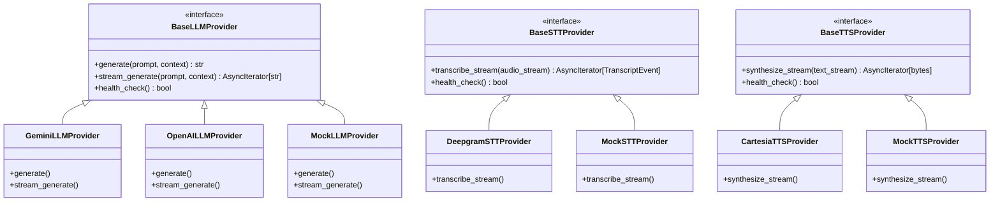

# Aarohi Provider Integration & Abstraction Layer

## 1. Provider-Independent Architecture

To avoid vendor lock-in and optimize operational latency and cost, Aarohi abstracts all AI and voice providers behind typed Python abstract base classes.

---

## 2. Supported Providers

### LLM Providers
1. **Google Gemini (Primary)**:
   - Default Model: `gemini-2.0-flash`
   - Benefits: High-speed token generation (<300ms time-to-first-token), superior multilingual Hinglish comprehension, cost efficiency.
   - Library: `google-genai` / `google-generativeai`
2. **OpenAI (Secondary / Alternate)**:
   - Default Model: `gpt-4o-mini`
   - Configurable for organizations with dedicated Azure OpenAI or enterprise agreements.
3. **Mock LLM (Automated Testing)**:
   - Returns deterministic, contextual mock interview follow-ups without internet connectivity or paid API tokens.

### Speech-to-Text (STT) Providers
1. **Deepgram (Primary)**:
   - Model: `nova-2`
   - Language: `en-IN` / `hi` (multilingual auto-detection)
   - Features: Interim streaming transcripts, smart punctuation, low latency (~150ms).
2. **Mock STT (Automated Testing)**:
   - Ingests mock audio chunks or text events for deterministic regression tests.

### Text-to-Speech (TTS) Providers
1. **Cartesia (Primary)**:
   - Model: `sonic-multilingual`
   - Voice: Indian Female Natural (`aarohi-indian-female-neutral`)
   - Latency: Ultra-low latency voice synthesis (<100ms first audio packet).
2. **Mock TTS (Automated Testing)**:
   - Emits synthetic byte chunks to verify WebRTC delivery pipelines without external API roundtrips.

---

## 3. Resilience & Failure Handling

- **Tenacity Retries**: Exponential backoff with jitter on transient network timeouts (HTTP 429, 503).
- **Graceful Fallbacks**: If streaming TTS encounters an error, Aarohi logs the event and falls back to a pre-cached synthetic prompt phrase ("I'm processing that, one moment...").
- **Zero Paid Calls During Testing**: Automated tests use `MockLLMProvider`, `MockSTTProvider`, and `MockTTSProvider`, guaranteeing zero API costs during CI/CD builds.
